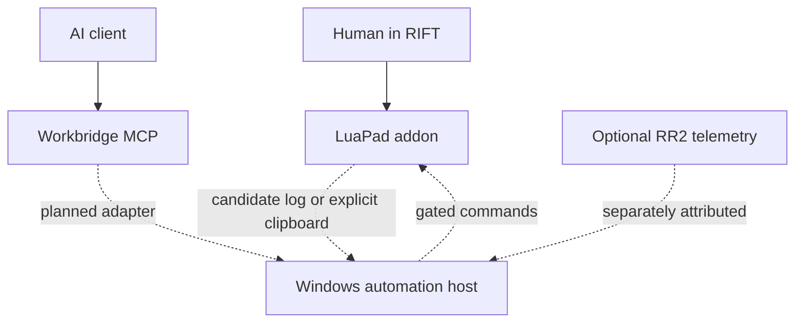

# LuaPadModern

**A modern in-game Lua editor, Inspector, and developer toolkit for RIFT — with an evolving, test-driven Windows automation bridge.**

[](docs/PREVIEW21-EDITOR-KEYBOARD-FOCUS-2026-11-06.md) [](RiftAddon.toc) [](https://www.trionworlds.com/rift/) [](main.lua) [](HostCore/)

> **Preview software.** The editor is usable in the physical RIFT client; the proposed AI/Workbridge end-to-end transport and autonomous Windows input are **not** complete. Features and tests below explicitly distinguish live verification from source-only prototypes.

## At a glance

| Area | Current state |
| --- | --- |
| In-game editor and Run | ✅ Implemented; native typing, Enter, Tab, and focus transitions physically verified |
| Startup, window layering, title | ✅ Centered/front in physical RIFT; auto-opens; author/version visible |
| Snippets, output, Inspector, clipboard | ✅ Implemented; check individual acceptance items for live coverage |
| Bridge JSON codec, router and `/lpb` pilot | 🧪 Source-only, tested; **not registered in RIFT** |
| Node log watcher and .NET 10 host core | 🧪 Source-only/synthetic tests; no verified live log transport |
| Win32 desktop input / MCP automation | 🚧 Planned; no end-to-end live bridge or general input guarantee |

**Latest verified checkpoint:** November 6, 2026 — `2.0.0-preview21`. Live RIFT evidence confirms clicking the editor requests focus, the indicator changes to **Editor: Focused**, ordinary characters and Enter/Tab work, and clicking outside changes it back to **Editor: Click to focus** without erasing the draft. See [Preview 21 acceptance evidence](docs/PREVIEW21-EDITOR-KEYBOARD-FOCUS-2026-11-06.md).

## Why LuaPadModern?

The original LuaPad is a useful in-game Lua scratchpad. LuaPadModern builds on that foundation for current RIFT UI use, safer diagnostics, predictable keyboard behavior, and repeatable engineering tests. It keeps the editor directly usable by a person while exploring a separately gated automation path for AI-assisted development.

- **Write and execute Lua in-game.** Run snippets directly from a code editor and inspect printed output and errors.
- **Stay in control of keyboard focus.** Startup and `/lp` do not steal game input; clicking the editor or focus indicator deliberately requests it.
- **Work alongside other addons.** The editor opens centered and raises itself above competing addon layers.
- **Keep useful snippets.** Account-scoped SavedVariables store reusable code; Save and Load controls are provided.
- **Inspect RIFT APIs and Lua data.** The bundled Inspector offers bounded diagnostics instead of unbounded traversal.
- **Copy diagnostics.** Output can be copied to the system clipboard, including full errors when the visible pane is shortened.
- **Build with regression coverage.** Lua runtime mocks, static checks, Node transport probes, and .NET host validation keep failure modes reproducible.

## Screenshots

Live visual captures, including hashes and acceptance steps, are documented in the [Preview 21 checkpoint](docs/PREVIEW21-EDITOR-KEYBOARD-FOCUS-2026-11-06.md). Screenshot assets are **not** committed to this repository; this section deliberately avoids placeholder images that could be mistaken for current UI.

## Requirements

### To use the addon

- RIFT Live with the supported addon system (developed and physically tested on the Windows x64 client).
- The complete addon folder: `main.lua`, `RiftAddon.toc`, `Inspector/`, `LibSimpleWidgets/`, and bundled image assets.
- A writable RIFT SavedVariables location for account-scoped snippets.

### To develop and run tests

- Windows 11 is the primary development host.
- **Node.js and npm** for the JavaScript verification commands and Lua runtime tests via `fengari-node-cli`.
- **.NET SDK 10** for `HostCore`, `HostCore.Tests`, and `HostProbe`.
- PowerShell for installation and preview deployment helpers.
- A physical RIFT client is required for genuine in-game verification; mocked tests cannot replace it.

## Install the addon

1. **Exit RIFT normally** before a first installation. Back up any existing LuaPad addon and SavedVariables.
2. Download or clone this repository:

   ```powershell
   git clone https://github.com/360madden/LuaPadModern.git
   cd LuaPadModern
   ```

3. Locate your RIFT `Interface\AddOns` folder. It is commonly under your Documents/RIFT profile; the exact path depends on your installation and OneDrive setup.
4. Copy the **runtime addon files only** into a folder named `luapad` below `AddOns`. Keep the directory structure:

   ```text
   AddOns/
   └── luapad/
       ├── RiftAddon.toc
       ├── main.lua
       ├── close.png
       ├── small_fangs.png
       ├── Inspector/
       │   ├── RiftAddon.toc
       │   ├── main.lua
       │   └── small_fangs.png
       └── LibSimpleWidgets/
           ├── RiftAddon.toc
           └── *.lua
   ```

5. Launch RIFT and check the addon list. LuaPad should open automatically, centered and above other addons. If closed, enter `/lp` in game chat to reopen it.

> **Installer caution:** `install-preview.ps1` contains the original developer machine's absolute AddOns path. **Review and edit `$addonsRoot` before running it on another PC.** It requires RIFT to be closed, backs up the prior addon and available SavedVariables, and performs a guarded installation. `deploy-preview*.ps1` scripts are historical, machine-specific hot-copy workflows; do not execute them as a generic installer.

## Quick start in RIFT

1. Open LuaPad (it auto-opens or use `/lp`).
2. Click inside the code editor. Confirm the status changes to **Editor: Focused**.
3. Enter a harmless script:

   ```lua
   print("Hello from LuaPadModern!")
   print("Current Lua version:", _VERSION)
   ```

4. Click **Run**. Examine the Output panel; errors should be displayed without permanently breaking the editor.
5. Use **Save** and **Load** to keep a useful snippet in an available slot.
6. Try **Inspect** for a bounded look at an available Lua/RIFT value. Use **Copy Output** to export diagnostics.
7. Click outside the editor to release text focus and return to ordinary game controls.

### Keyboard and focus behavior

| Action | Expected behavior |
| --- | --- |
| Start RIFT or type `/lp` | Window becomes visible; **does not** automatically take keyboard focus |
| Click editor body or focus badge | Requests `RiftTextfield:SetKeyFocus(true)` and verifies `GetKeyFocus()` |
| Enter | Inserts a newline |
| Tab | Inserts spaces (including replacing a selection) |
| Click outside editor | Focus indicator returns to unfocused; draft code stays |
| Close LuaPad | Hides window and releases editor key focus |

The focus indicator reflects addon-side RIFT state. It is **not** proof that an external Windows automation host has independently verified the game foreground window, PID/HWND, geometry, and occlusion.

## Feature details

### Editor and execution

The editor includes a draggable window, a unified toolbar, readable section headings, scrollable code/output regions, native textfield keyboard handling, and protected execution. Nested Run attempts are guarded; runtime exceptions are captured rather than leaving temporary print hooks installed. Selection-aware Enter/Tab insertion and UTF-8-safe text trimming have dedicated regressions.

### Inspector and diagnostics

The bundled Inspector supports constrained expression evaluation and bounded table traversal. Output and error previews enforce rendering limits to avoid extremely large UI widgets; full diagnostics remain available for clipboard export when possible. Unicode truncation avoids cutting through UTF-8 code points.

### Persistence and clipboard

`LuaPad_Snippets` is declared as account-scoped SavedVariables in `RiftAddon.toc`. Save/Load relies on RIFT's persistence behavior. Clipboard export is an explicit user action; it should not be confused with a streaming host transport.

### RIFT addon sandbox

RIFT addons operate under the game's own capability and event model. A Lua addon does not automatically have generic Windows filesystem, socket, or HTTP access. The [sandbox and security research](docs/RIFT-ADDON-SANDBOX-SECURITY-2026-11-06.md) distinguishes supported RIFT APIs from unverified host-side assumptions.

## Architecture and automation roadmap



**Solid arrow:** current direct user interaction or existing Workbridge coordination. **Dashed arrow:** proposed or unverified end-to-end integration; do not treat it as an operational connection.

| Component | Location | Purpose | Current verification |
| --- | --- | --- | --- |
| In-game addon | `main.lua`, `Inspector/`, `LibSimpleWidgets/` | UI, Lua Run, snippets and inspection | Physical RIFT + mock tests |
| Bridge v1 | `Bridge/`, `contracts/` | Correlated envelopes, safe query routing, source-only slash adapter | Source/runtime tests; not loaded by RIFT |
| Log probe | `tools/rift-log-probe.cjs` | Bounded read-only detection of tagged messages in a RIFT log | Synthetic file tests; live transport unverified |
| .NET 10 core | `HostCore/`, `HostCore.Tests/` | Validate responses and readiness; read-only log tail | Source-only host tests |
| Host probe CLI | `HostProbe/` | Opt-in tagged log observation | Synthetic cross-process acceptance |
| Future desktop host | Design in `docs/` | Exact-window input, UI evidence, clipboard and request queue | Not built end-to-end |

Bridge envelopes use a versioned `luapad-bridge` protocol with `requestId`, `sessionId`, an operation, and structured status/result/error fields. The host must reject stale/mismatched responses and verify readiness before any game input. `/lpb` is a **source-only pilot** and is **not currently registered as an in-game slash command**.

**Important transport distinction:** LuaPad's Run output pane captures `print`; this does *not* prove that text reaches RIFT `Log.txt`. A candidate opt-in `/log` + `Command.Console.Display` path and its real latency/fidelity are still awaiting physical acceptance.

Read the [architecture](docs/AUTOMATION-ARCHITECTURE.md), [M0–M7 roadmap](docs/AUTOMATION-ROADMAP.md), [focus gate](docs/UI-FOCUS-AUTOMATION-GATE-2026-11-04.md), and [bridge schema](contracts/bridge-envelope-v1.schema.json).

## Testing and verification

From the repository root in **PowerShell**:

```powershell
# Static package checks
node verify-preview.cjs

# Strict Lua mock/runtime + bridge assertions (uses npm/Fengari)
node verify-bridge.cjs

# Source-only .NET host assertions; requires .NET SDK 10
node verify-host.cjs

# Additional contract and transport tests
node contracts/verify-contract.cjs
node tools/rift-log-probe-tests.cjs
node tools/rift-log-probe-cli-tests.cjs
node tools/verify-host-probe-cli.cjs
```

The strict bridge runner invokes `npm exec --yes --package=fengari-node-cli`; an initial run may download a package. It validates expected success sentinels **and** rejects tracebacks because a Lua runner can otherwise exit successfully despite a printed error. The host gate compiles and runs a .NET 10 test project.

| Suite | Last recorded checkpoint (2026-11-06) | Scope |
| --- | ---: | --- |
| `verify-preview.cjs` | 60 / 60 | Structural checks |
| `verify-bridge.cjs` | 496 / 496 | Lua runtime, bridge and sandbox mocks |
| `verify-host.cjs` | 113 / 113 | Source-only .NET host assertions |
| `rift-log-probe-tests.cjs` | 40 / 40 | Synthetic log handling |

These are **historical recorded passes**, not continuously updated CI badges. Run the commands on your machine for fresh evidence. Physical acceptance is tracked separately in the [Preview 21 report](docs/PREVIEW21-EDITOR-KEYBOARD-FOCUS-2026-11-06.md) and [test plan](TEST-PLAN.md).

## Current limitations

- The automation bridge codec/router/slash pilot is not installed or registered in the active RIFT addon.
- There is no released Windows desktop dashboard, generalized input controller, or live MCP tool for arbitrary Lua execution.
- RIFT `Log.txt` delivery, message framing, buffering, and latency remain unverified against a live client.
- Some older test-plan entries remain open; use dated acceptance reports rather than assuming every toolbar action has recent live proof.
- Installation scripts include developer-specific paths; use the manual method or adapt them carefully.
- A public release/license decision is separate from GitHub visibility. No new license is asserted here.

## Project layout

```text
LuaPadModern/
├── main.lua                     # LuaPad runtime UI and execution
├── RiftAddon.toc                # RIFT addon metadata and version
├── Inspector/                   # Bundled Inspector addon
├── LibSimpleWidgets/            # Bundled widget library
├── Bridge/                      # Source-only JSON, routing and UI-state pilots
├── contracts/                   # Protocol schema, examples, contract check
├── HostCore/                    # .NET 10 validation and log-tail library
├── HostCore.Tests/              # Source-only host regressions
├── HostProbe/                   # Opt-in managed probe CLI
├── tools/                       # Test runners and log probe utilities
├── docs/                        # Architecture, milestones and evidence
├── verify-*.cjs                 # Primary verification entry points
├── deploy-preview*.ps1          # Machine-specific staged deploy helpers
└── install-preview.ps1          # Guarded installer; path review required
```

`backups/` and generated build folders are deliberately ignored by Git.

## Documentation index

- [Development history and detailed preview change log](docs/DEVELOPMENT-HISTORY.md) — the original long-form README retained intact.
- [Preview 21 editor focus: live evidence](docs/PREVIEW21-EDITOR-KEYBOARD-FOCUS-2026-11-06.md)
- [Automation architecture](docs/AUTOMATION-ARCHITECTURE.md) and [roadmap](docs/AUTOMATION-ROADMAP.md)
- [RIFT addon sandbox capability study](docs/RIFT-ADDON-SANDBOX-SECURITY-2026-11-06.md)
- [M2 bridge codec](docs/M2-CODEC-CHECKPOINT-2026-11-04.md), [router/focus](docs/M2-ROUTER-FOCUS-CHECKPOINT-2026-11-04.md), and [slash pilot](docs/M2-SLASH-TRANSPORT-PILOT-2026-11-04.md)
- [M3 host core](docs/M3-HOST-CORE-CHECKPOINT-2026-11-04.md) and [noncombat log tail](docs/M3-NONCOMBAT-LOG-TAIL-CHECKPOINT-2026-11-04.md)
- [Original and preview deployment notes](DEPLOYMENT-2026-11-03.md)

## Maintainers and attribution

**LuaPadModern:** Joey Delfierro (`360madden`). Based on **LuaPad 1.8 by NerfedWar**; the original upstream attribution remains in source and addon metadata. The repository also contains Inspector and LibSimpleWidgets components with their own provenance. Contributions and bug reports can be filed through [GitHub Issues](https://github.com/360madden/LuaPadModern/issues); include the preview version, RIFT client build, steps to reproduce, observed/expected behavior, and any safely shareable diagnostic output.

**Repository:** https://github.com/360madden/LuaPadModern
